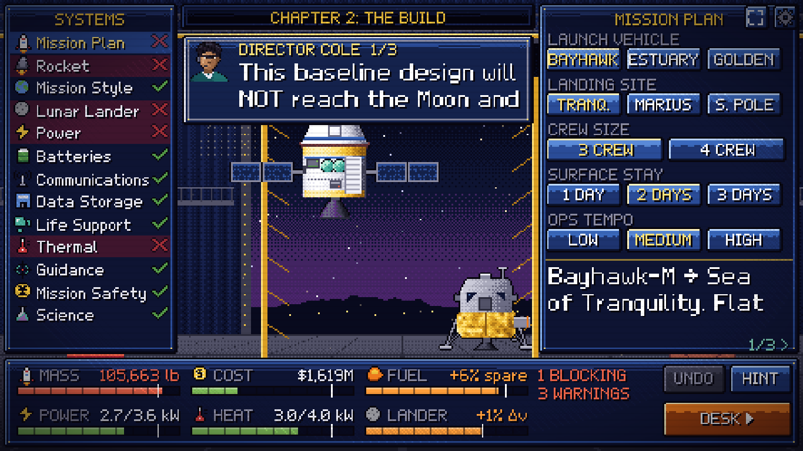
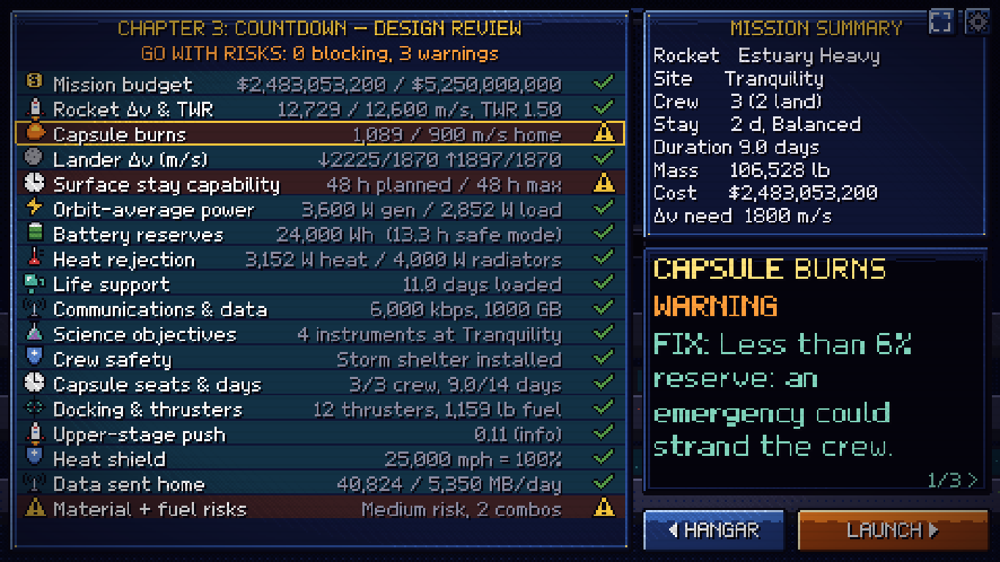
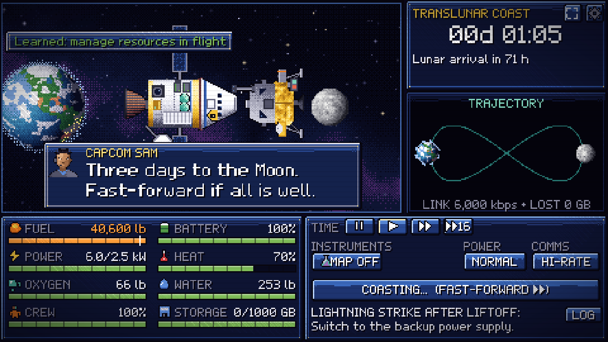
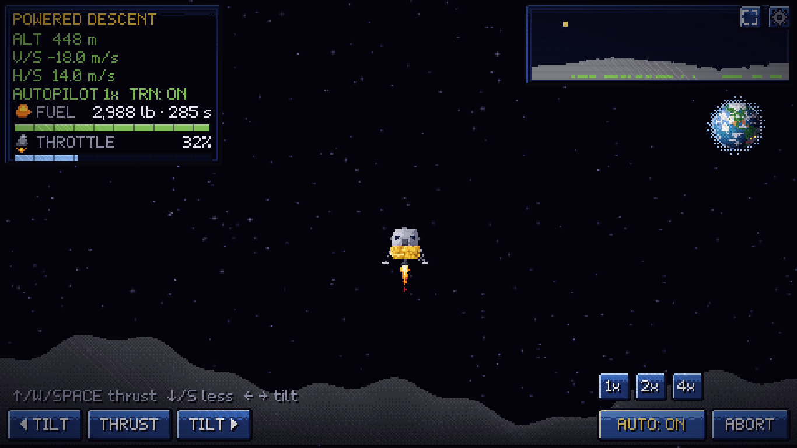
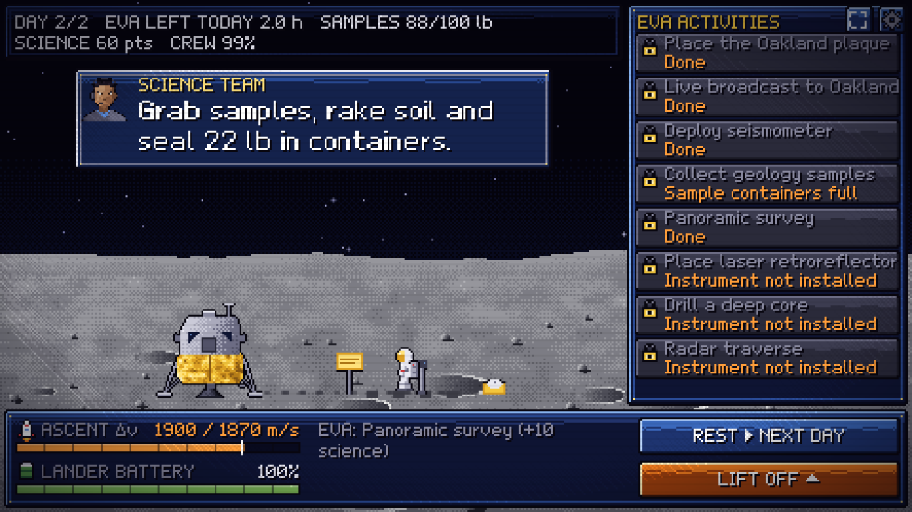
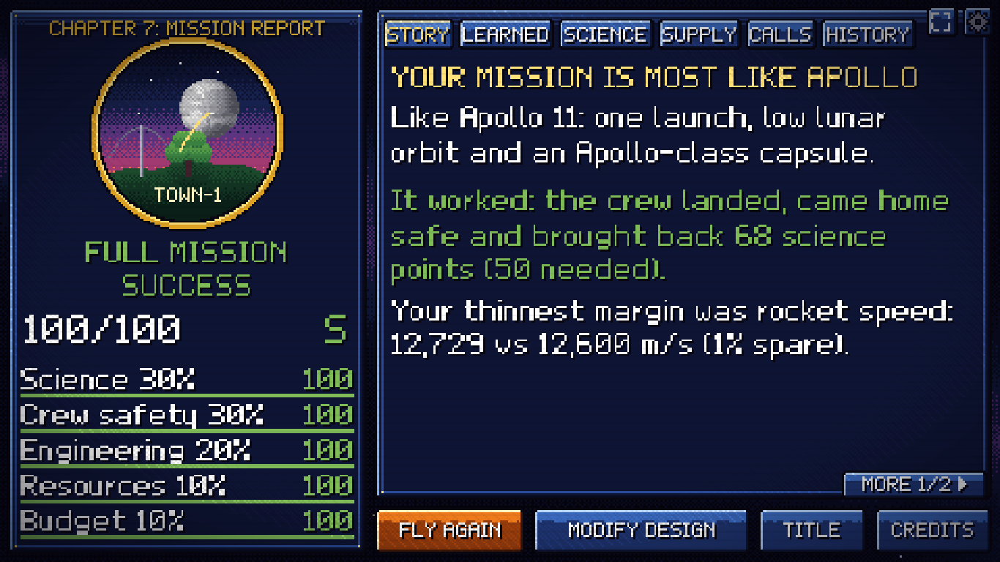

# OAKLAND TO THE MOON
### *From the Town to the Stars.*

A single-player, 16-bit spacecraft engineering game for the **2026 NASA Space Apps Challenge:
Space Mission Design Game**. Commander Kai Alvarado (fictional) leaves the streets of Oakland,
California, to lead a crewed mission. You design the spacecraft and its rocket, check the math,
pass a design review, then fly the mission you built: launch, emergencies, a lunar landing,
science on the surface and the trip home. **Your design decides what is possible.**

**Play in your browser:** https://bryandev07.github.io/oakland-to-the-moon/
*(available after the first GitHub Pages deployment; see [Deployment](#deployment))*

> **Judges:** choose **QUICK START** on the title screen (or press **Q**) to skip the story and go
> straight to the spacecraft builder. **NEW MISSION** plays the full Oakland story.


## What you do

1. **Oakland** (story): walk the block, say goodbye to the neighborhood, then get your briefing at Mission Control.
2. **Pick a role and difficulty.** Mission Commander (+5% budget), Propulsion Engineer, Spacecraft
   Engineer or Science & Comms Lead; Easy (sandbox, worked examples) or Hard (realistic).
3. **Pick a mission:** **Moon Landing** (land two astronauts, bring home 50 science points) or
   **ISS Rescue** (dock with the station and fix a solar panel on a spacewalk).
4. **Build in the hangar.** Choose a crew capsule (Orion, Apollo-class or a budget Earth-orbit capsule),
   a lunar orbit (Apollo's low orbit or Artemis's halo orbit), one launch or two, a lander, power,
   batteries, radios, data storage, life support, radiators, guidance, safety systems and science
   instruments. You can also build a custom rocket from real engines (Merlin, BE-4, RS-25, RL10),
   tank materials and boosters. Meters show mass, cost, fuel, power, heat and lander Δv as you go.
5. **Check the math at the Calculation Desk.** Five notebook sheets (can it lift off, can it reach
   the Moon, can it get home, can the crew survive, can it phone home) walk through the real
   formulas; the player does the additions.
6. **Design review (GO / NO-GO).** Red items block launch; orange items are risks, each with a plain-words fix.
7. **Fly it.** Launch with staging, a 3-day coast with time warp, power and comms modes,
   instruments and emergency cards (many based on real events, such as Apollo 13 and Starliner, with
   sources), lunar orbit insertion, a landing you fly yourself or by autopilot, EVAs, the ascent
   (heavy samples can keep you down), the burn home, re-entry and splashdown.
8. **Mission report:** score, what worked, your thinnest margin, which real mission your design is
   most like (Apollo, Artemis or a hybrid), the decisions you made and a comparison with your last run.

| | |
|---|---|
|  |  |
|  |  |
|  |  |

## What makes it educational

* **Real relationships, visible trade-offs.** The staged rocket equation decides whether the rocket
  reaches 12,600 m/s; the capsule's service module must brake into lunar orbit and still have the
  Δv to come home; batteries must carry the loads through every lunar-orbit shadow; data must be
  sent home before the recorder fills; oxygen, water and food are loaded per astronaut per day.
* **Real architecture lessons emerge from the numbers.** Orion with an Apollo-style lander in low
  lunar orbit runs out of propellant; the halo orbit with two launches works. That is why Artemis
  flies the way it does.
* **No single right answer.** Apollo-style and Artemis-style designs, lean and heavy, can all succeed.
  Every failure says what went wrong and what to change.
* **Honest numbers.** Every value is tagged **R** (real, sourced) or **G** (game value) in
  `src/data/specParts.ts`. The in-game **Science library** (pause menu) lists every formula and part
  value. Simplifications are listed in [`docs/SCIENTIFIC_ASSUMPTIONS.md`](docs/SCIENTIFIC_ASSUMPTIONS.md),
  and references are in [`SOURCES.md`](SOURCES.md).
* **Learning goals** appear in the briefing, pop up when met and are checked in the report.
  Explanation levels (beginner, curious, engineer), larger text, reduced motion and status icons are in Settings.

## Controls

| Action | Keys / mouse |
|---|---|
| Everything | Mouse: click buttons and options |
| Confirm, next line | **Enter** (or Space / Z in dialogue) |
| Choose an option | **1-4**, or arrow keys + Enter |
| Pause, settings, help, science library | **Esc** or the gear icon |
| Fullscreen | **F** or the corner-brackets icon |
| Quick start (title screen) | **Q** |
| Calculation Desk | Number keys type the sum; **S** skips a sheet; **E** shows a worked example (Easy) |
| Flight: pause time / mission log | **Space** / **L** |
| Landing | **Up / W / Space** thrust, **Down / S** less, **Left / Right** tilt, or the autopilot |

## Run it locally

Requires Node.js 20.19+ (or 22.12+).

```bash
npm install
npm run dev          # http://localhost:5173
```

Production build (a static site in `dist/` that can be hosted anywhere, including a subfolder):

```bash
npm run build
npm run preview      # http://localhost:4173
```

## Tests

```bash
npm run test         # Vitest: 195 unit tests of the simulation, formulas, review and scoring
npm run test:e2e     # Playwright: 7 browser tests, including a full Moon mission and a full ISS
                     # mission played through the real UI, quick start, save/continue and text fit
npm run screenshots  # same browser tests, saving the README screenshots to docs/screenshots
npm run typecheck    # TypeScript, strict
```

The browser tests use the installed Google Chrome. To use Playwright's own browser instead, run
`npx playwright install chromium` and set `PW_CHANNEL=chromium`. A normal `npm run test:e2e` saves
its screenshots in the git-ignored `test-results/` folder.

Other commands: `npm run assets` regenerates all pixel art procedurally.

## Deployment

`.github/workflows/deploy.yml` runs the unit tests, builds the game and publishes `dist/` to
GitHub Pages on every push to `main` (or on demand from the Actions tab). One-time setup:
**Settings > Pages > Build and deployment > Source: GitHub Actions**. The build uses relative asset
paths (`base: './'` in `vite.config.ts`), so it works at
`https://bryandev07.github.io/oakland-to-the-moon/` without changes.

## Project layout

```
src/simulation/   pure TypeScript physics and rules (no Phaser): rocket stack, spacecraft model,
                  design review, flight simulation, landing, surface, emergencies, scoring
src/data/         parts catalog with R/G tags, missions, roles, learning goals, card sources
src/game/scenes/  18 Phaser scenes (title, Oakland, briefing, hangar, desk, review, launch,
                  flight ops, docking, spacewalk, landing, surface, return, report, ...)
src/game/ui/      pixel UI kit, dialogue, emergency cards, tooltips
scripts/          procedural art generator and helper scripts
tests/            unit tests (tests/unit) and browser tests (tests/e2e)
docs/             design spec, scientific assumptions, architecture, art direction, screenshots
```

## How this game was made (AI-assisted development)

The team designed the game, wrote the mission design notes and part data
([`docs/JOSEPH_SPEC.md`](docs/JOSEPH_SPEC.md)), chose the sources and made the design decisions.
Much of the code, the procedural pixel art and music, the tests and the documentation were written
with AI coding assistants (including Claude Code) working from those notes, then reviewed, played
and corrected by the team. Simulation numbers are tagged real or game values so that nothing
invented is presented as fact.

## Credits and disclaimer

All code, pixel art, music and sound are original and generated by this repository; there are no
third-party art or audio assets. Real spacecraft, engines and historical events are named for
education and cited in [`SOURCES.md`](SOURCES.md). The agency, rockets, crew and the TOWN-1 mission
are fictional. **Not affiliated with or endorsed by NASA.** Code is under the [MIT License](LICENSE).
