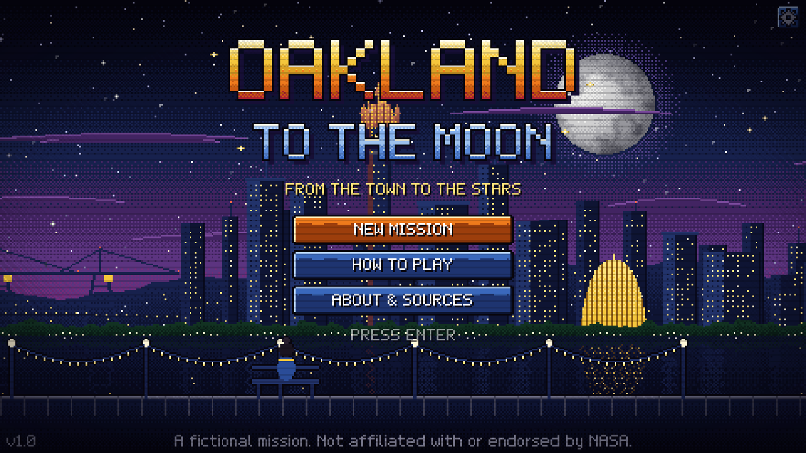

# OAKLAND TO THE MOON
### *From the Town to the Stars.*

A single-player, 16-bit space mission engineering game for the **2026 NASA Space Apps Challenge —
Space Mission Design Game**. Lead Commander Kai Alvarado (fictional) from the streets of Oakland,
California, through building a spacecraft, launching it, landing on the Moon, doing science, and
bringing the crew home. **Your design decides what is possible.**



## Play

```bash
npm install
npm run dev          # http://localhost:5173
```

Production build (static site, deploy `dist/` anywhere):

```bash
npm run build
npm run preview      # http://localhost:4173
```

## Tests

```bash
npm run test         # Vitest: 52 simulation unit tests
npm run test:e2e     # Playwright: plays a full mission through the UI (uses installed Chrome;
                     # set PW_CHANNEL=chromium after `npx playwright install chromium` if needed)
npm run assets       # regenerate all pixel art procedurally
```

## How to play
1. **Oakland** — walk the block (click where to walk, or hold →). Say goodbye to the neighborhood.
2. **The Build** — in the hangar, pick a part in each of 13 systems plus the mission plan
   (rocket, landing site, crew, surface stay, tempo). Watch the meters: mass vs. rocket, cost vs.
   budget, propellant margin, power, heat, lander Δv. Red icons point at the problem; HINT explains the fix.
3. **Countdown** — the design review lists blocking failures (red) and acceptable risks (orange). Launch when GO.
4. **The Journey** — manage the flight: time warp, instruments, power and comms modes. Respond to emergencies.
5. **Lunar Operations** — orbit insertion, map in sunlight, fly the landing (↑/W/Space, ←/→, or autopilot),
   then spend EVA hours on science. Samples weigh down your ascent stage!
6. **The Return** — trans-Earth injection, entry, splashdown, and a homecoming in Oakland.
7. **Mission Report** — transparent score, failures, recommendations, and comparison with your last run.

Keys: Enter confirm • Esc pause/settings/help • 1–4 choose options • Space pause time (ops).

## What makes it educational
- Real relationships: rocket equation with staged burns, battery energy balance through lunar
  eclipses, data-storage balance with far-side loss of signal, life-support consumption rates.
- No single perfect build: lean, balanced and heavy architectures can all succeed.
- Failures are explainable and the report tells you what to change.
- See [`docs/SCIENTIFIC_ASSUMPTIONS.md`](docs/SCIENTIFIC_ASSUMPTIONS.md) and [`SOURCES.md`](SOURCES.md).

## Project docs
[Game design](docs/GAME_DESIGN.md) • [Architecture](docs/ARCHITECTURE.md) •
[Art direction](docs/ART_DIRECTION.md) • [Development status](docs/DEVELOPMENT_STATUS.md)

## Credits & disclaimer
Code, art, music and sound are original and procedurally generated by this repository.
The agency, rockets, characters and mission are fictional. **Not affiliated with or endorsed by NASA.**
